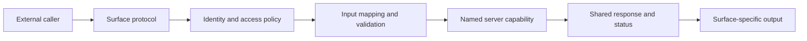

# Stackpress Interfaces And Experience

## Access Surfaces

Stackpress exposes shared server capabilities through multiple adapters:

| Surface | External contract | Access responsibility |
| --- | --- | --- |
| CLI | parsed command and flags | local operator/process policy |
| page/admin | route, request, session, form/CSRF | route and page authorization |
| configured API | HTTP method, path, headers, body | public/app/session identity and scopes |
| OAuth | browser and token flows | application/session records and secrets |
| MCP | tool schemas over stdio, HTTP, or SSE | key verified on every request; public/app/user context and every listed scope; stdio unfiltered |
| built-in agent | chat routes, streamed events, browser panel | the request's signed-in session only, plus anti-forgery token, approval, daily limit |
| desktop | Electron shell, menu, local runtime request | local token and route policy |
| plugin | in-process event call | trusted code or explicit application checks |

Named events are the shared internal invocation protocol. They do not make these
callers equivalent or apply one universal security policy.

## Exposure Models

- Generated model listeners create internal domain capabilities.
- Generated admin routes expose model workflows during `route`.
- Configured API endpoints explicitly map method/path/caller policy to an event.
- MCP can generate model tool definitions and plugins can contribute tools
  through an event, while config selects final visibility, overrides, caller
  type, and transport. A tool's type defaults to public.
- The built-in agent offers only tools marked for it, as the signed-in person.
- Both run a tool through one shared execution path and hand its event a caller
  record kept apart from input.
- CLI packages register operational commands as events.
- Desktop packages register optional local commands and contribution events.

Generation supplies candidate integrations; it does not expose every capability
through every surface automatically.

## Surface Adapter Flow

Equivalent operations can legitimately have different identity, validation,
error, and presentation contracts. Direct in-process event resolution has no
automatic caller authorization.

## Outside Callers, Agent, And Sessions

Outside MCP callers present a key. It must be known, active, unexpired, and
secret-matching; a bad key is refused with 401 rather than downgraded, a call to
a tool the caller lacks is 403, a session ends when its key dies, and a valid
caller that sees no tools gets an empty list. stdio is trusted local use.

The built-in agent has no account. It acts as the signed-in person, derived only
from the request's verified session, and the target event stays the final
authority. Irreversible or inverse-less writes wait for approval, reversible
ones are logged with undo through a declared inverse, and a person's token use
is capped per day.

Two verified mechanisms shape any event meant for these callers:

- Resolving an event with plain data builds a request with no session, so an
  event that reads its caller from the session refuses it.
- A caller's session therefore has to be carried in a new request built for the
  purpose. That request holds the whole session and only the tool arguments;
  the origin request, with its body, headers, and query, is never forwarded.

Proven only against the blog template: the Anthropic and OpenAI connections ran
against canned replies, only OpenRouter ran live, store concurrency ran on the
in-memory test database, and nothing ran on a production application or a
hosting platform.

## Host-Routed React

Ingest owns route matching and page action order. A page handler resolves data
and capabilities, selects a React entry, and places response data into the view
pipeline. stackpress-view adapts Reactus as the SSR, asset, build, and hydration
engine.

The view adapter passes a serialized server snapshot containing:

- configured and response data;
- public session details;
- URL fields, headers, request-session data, method, MIME type, and request data;
- normalized response status, errors, results, and totals.

Reactus renders the selected page on the server, embeds the props, and hydrates
the browser with the same snapshot. Client request/response/session wrappers are
readonly helpers over serialized data, not live server objects.

Rendering is skipped for redirects, the configured no-view request flag, or an
existing string body. Development mode can let Reactus/Vite middleware handle
assets and HMR before the response completes.

## Browser Snapshot Boundary

Everything in rendered props is browser-visible and must be intentionally safe
to expose and JSON-serializable. Functions, cyclic structures, native resources,
server secrets, and unnecessary request/session fields do not belong in the
snapshot.

No framework-wide prop allowlist or complete snapshot escaping policy is an
accepted current guarantee. Security-sensitive applications should minimize
forwarded fields and test hostile values, SSR output, and hydration.

## UI And Localization Ownership

- stackpress-view generates role-specific form/filter/list/span/view wrappers;
- stackpress-admin composes generated CRUD pages and routes;
- Frui supplies generic behavior-focused React components, not application
  layout/theme/brand policy;
- r22n translates source phrases and preserves React nodes in interpolation;
- Stackpress config and language/session packages choose locale and caller state;
- Reactus owns rendering/build mechanics, not application routes or domain data.

Generated wording is part of the translation contract. Generated structure does
not replace rendered accessibility and interaction verification.

## Cross-Surface Risks

- access policy can diverge between page, API, MCP, and agent mappings;
- nested event calls can lose caller context unless intentionally propagated;
  an event resolved with plain data has no session;
- the agent checks sign-in only, so a tool event must authorize the person;
- MCP counts an unanswered event as success while the agent counts it failed;
- validation and errors can map differently by protocol;
- generated definitions and configured exposure can drift;
- audit identity and tracing are not automatically centralized.

## Detailed Reference

Load [Runtime API Contracts](../references/00004-runtime-api-contracts.md) when
an interface document needs exact request, response, routing, server, or status
contracts.

Load [Stackpress Configuration Catalog](../references/00008-configuration-catalog.md)
for view, brand, language, session/auth, API, admin, cookie, CSRF, MCP, agent, and
desktop policy that shapes external experiences.

Load [AI Tools, Callers, And MCP Access](../references/00019-ai-tools-callers-and-mcp-access.md)
for key verification, the tool contract, contribution, the caller record, and
carrying a session into an event.

Load [AI Agent Runtime, Records, And Panel](../references/00020-ai-agent-runtime-records-and-panel.md)
for the agent turn, approval and undo, chat routes, stored records, providers,
the browser panel, and the package's import paths.

Load [View API Contracts](../references/00012-view-api-contracts.md) for Reactus
SSR/build behavior, view lifecycle, serialized browser props, hooks/providers,
layouts, notifications, aggregate admin helpers, or `setViewProps`.

Load [Session And Language Contracts](../references/00013-session-language-contracts.md)
for JWT/session lifecycle, permission matching, global route authorization,
auth actions, locale selection/persistence, or r22n browser translation.

Load [Interface Exposure Examples](../references/00017-interface-exposure-examples.md)
when adapting one event into a handwritten page, configured API endpoint, MCP
tool, agent tool, or cross-surface policy comparison.
